<p align="center">
  
</p>

<p align="center">
  634 animated ASCII art pieces for web pages, READMEs, wallpapers and terminals.<br>
  Scenes, interfaces, charts, diagrams, 3D shapes, loaders, games, dividers and more, in 24 categories.<br>
  <a href="https://www.ascii-magic.com/ascii">Browse the library</a> ·
  <a href="https://www.ascii-magic.com/ascii/docs">Docs</a> ·
  <a href="https://www.ascii-magic.com/ascii/banner">Make a README banner</a> ·
  <a href="https://www.ascii-magic.com/ascii/use">Use cases</a>
</p>

## Add one to your project in one prompt

```bash
npx ascii-magic-art
```

Browse all 634 pieces live in your terminal. Arrow keys move between pieces and categories, `s` changes the look (halftone dots, ASCII, binary, dither and more) and `a` redraws text and line art too. Press enter and a prompt for that piece, in that look, is copied to your clipboard: paste it into Claude Code, Cursor, Copilot or any coding agent and it adds the piece to your site. Or skip the browsing:

```bash
npx ascii-magic-art prompt matrix-rain
```

## Play one in your terminal

```bash
npx ascii-magic-art moonlit-sea
npx ascii-magic-art --list
npx ascii-magic-art matrix-rain --seconds=3    # stop on its own, for shell startup
npx ascii-magic-art sleeping-cat --frame       # print one still frame, for a MOTD
```

Any key stops it. Add `--look=dots` (or `ascii`, `numbers`, `binary`...) or `--chars=" .oO@"` to redraw it in other characters. Colour turns off when output is piped or `NO_COLOR` is set.

## Put one on a web page

```html
<script type="module" src="https://www.ascii-magic.com/ascii/ascii.js"></script>

<ascii-art piece="moonlit-sea"></ascii-art>
```

Attributes:

| attribute | what it does |
|-----------|--------------|
| `piece`   | the piece name, as in the URL of its page |
| `size`    | font size in px (default 12) |
| `speed`   | playback speed, 1 is normal |
| `still`   | show one frame, no animation |
| `bg`      | background colour behind the art |
| `look`    | redraw it in another character set: `dots`, `ascii`, `dense`, `numbers`, `binary`, `letters`, `blocks`, `squares`, `lines`, `dither` |
| `chars`   | your own characters instead of a look, e.g. `chars=" .oO@"` (sorted light to dark for you) |
| `mono`    | one colour instead of the piece's palette |
| `all`     | with `look` or `chars`, redraw text and line work too, not only shading |
| `contrast`| 0 to 100, default 0 |
| `dot-size`| halftone dot size for the `dots` look, 25 to 120, default 51 |
| `density` | halftone dot spacing, 40 to 250, default 131 (more dots, same size) |
| `steps`   | halftone dot sizes: `3`, `5`, or `0` for smooth |

The element plays only while it is on screen, and holds a still frame for visitors who prefer reduced motion.

## Use a piece in your own code

```bash
npm install ascii-magic-art
```

Every piece is one small ES module with no dependencies apart from `lib/kit.js`. It exports `meta` and a `create()` function that returns `draw(t)`, a function from seconds to a frame:

```js
import create, { meta } from "ascii-magic-art/pieces/spinning-torus.js";

const draw = create();
const frame = draw(1.5);            // a string, or { text, color }
console.log(frame.text ?? frame);
```

A frame with colour has a `color` layer the same shape as `text`. Each character in it is a key into `meta.palette` (a space means the default ink). `runtime/player.js` turns that into HTML; `runtime/canvas.js` draws it to a canvas for PNG, GIF and video export.

## Looks

Every piece can be redrawn in a different set of characters. Each cell's darkness comes from how much ink its glyph covers and how bright its colour is; the look's characters are sorted by ink and the nearest one is drawn. Shading blocks are redrawn, text and line work stay as they are (pass `all: true` to redraw everything).

```js
import { restyle, withLook } from "ascii-magic-art/runtime/glyphs.js";

const frame = restyle(draw(1.5), meta.palette, { look: "dots" });
const drawInNumbers = withLook(create(), meta.palette, { look: "numbers" });
```

## Make a piece

```js
import { Grid } from "../lib/kit.js";

export const meta = {
  slug: "my-piece", name: "My Piece", category: "generative",
  note: "One line about it.", tags: ["loop", "minimal"],
  cols: 60, rows: 20, fps: 24,
};

export default function create() {
  const g = new Grid(meta.cols, meta.rows);
  return (t) => {
    g.clear();
    g.text(2, 2, "hello " + Math.floor(t));
    return g.frame();
  };
}
```

Then check it:

```bash
node scripts/validate.mjs my-piece
```

The validator checks the size of every frame, the character set, that it animates, and that each frame draws in under 12 ms.

## Licence

MIT. Use the pieces anywhere, including commercial work. A link back is appreciated, not required. Two photo-based scenes, `ocean-sunset` and `starry-ridge`, keep the Unsplash License of their source photos; see [NOTICE](NOTICE).

Want your own photo, logo or video as animated ASCII? That is what [ASCII Magic](https://www.ascii-magic.com) does.
